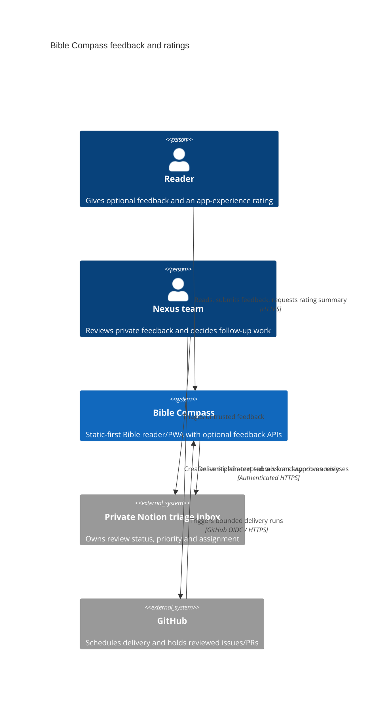
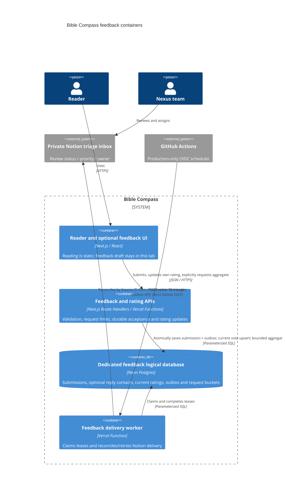

# Feedback and ratings architecture

The reader remains static-first. Feedback and ratings are optional modules; their APIs, database or Notion can fail without blocking Scripture reading or push reminders. No accounts, screenshot uploads, public feedback list or automatic GitHub issue creation are introduced.

## C4 context



## C4 containers



The feedback database uses its own connection and role. It does not read notification subscriptions, push keys or reminder management tokens. A separate logical database still shares the Neon project's compute/backup lifecycle; it is not physical fault isolation. Preview data and credentials are separate from Production, and the Preview cron handler never writes to the live Notion inbox.

## Durable acknowledgement and retries

Feedback POST validates bounded JSON, same-origin browser requests, server-side request limits and allowlisted context. It commits the original submission and one outbox row in a transaction before returning an opaque reference. That reference does not grant public read access. Notion failure does not undo acceptance. An idempotency key and normalized payload hash preserve the original receipt after an uncertain browser acknowledgement; the same key with a changed payload is rejected.

The worker's atomic `FOR UPDATE SKIP LOCKED` claim increments the attempt count and sets a fresh UUID lease token with a five-minute lease. At most three items are processed per run, sequentially, with bounded provider calls and a 40-second start-work budget. Completion or retry updates require the same outbox ID and lease token, preventing an old worker from overwriting a newer claim. An expired lease is reclaimable; an exhausted eighth attempt is moved into a visible failed state even if its worker crashed. Retry uses exponential backoff with jitter and honors a bounded Notion Retry-After. Terminal failures need operator review and an explicit replay after correcting the cause.

Before every create, the worker searches the configured Notion data source's Source ID for the stable submission UUID. One match reconciles a prior create; multiple matches stop delivery for review. A create timeout remains unconfirmed and is retried through reconciliation. Notion has no cross-system transaction or unique constraint, so a timeout combined with delayed query visibility can still produce duplicate pages; this is not an exactly-once guarantee.

No Notion credentials means the cron returns a configuration error without claiming an item. Intake can continue safely queueing in Postgres. GitHub schedule timing is best-effort and may be delayed or disabled by inactivity. Workflow failures and failed/past-due outbox rows require Nexus operator attention; the scheduler is not a guaranteed delivery SLA.

An authorized Nexus operator should inspect delivery failures and queue age during regular triage, independently of the worker's per-run counts. This read-only query contains no submission text or contact information:

```sql
SELECT state, count(*) AS items, min(created_at) AS oldest_received,
  min(next_attempt_at) AS earliest_attempt
FROM feedback_outbox GROUP BY state;
```

Investigate failed rows and overdue/expired leases rather than clearing them blindly. Correct destination credentials/schema first, reconcile the stable Source ID in Notion, and only then explicitly replay selected rows through an authorized maintenance session. Do not delete the original submission, generate a new source ID or bulk reset attempts to hide a failed integration. This release does not add or claim an autonomous team-review agent or a queue alerting service.

## Data and triage boundaries

Postgres owns original submissions, optional reply contacts, delivery bookkeeping and current installation ratings. Notion owns triage status, priority and owner. Every submission page starts with an untrusted-data notice; descriptions and optional bug details become plain rich text, never Markdown interpreted as instructions. Raw submissions do not authorize agents to execute links, change security settings, open public issues, merge PRs or deploy. Slack receives reviewed decisions or aggregate operational status rather than raw submissions.

The worker does not copy optional reply email to Notion. Authorized operators can retrieve a contact privately through a parameterized database query using the Source ID after deciding a reply is needed. No public contact or raw-intake API is added. Retention/deletion procedures must cover raw submissions, separate contacts, delivered Notion copies and provider backups; workflow status in Notion must not silently recreate deleted intake.

Overall rating retrieval is a separate, on-demand read-only aggregate. Opening the app/form or saving a rating does not fetch it. Only View app rating, Refresh and Retry do so. The summary exposes average/count/star distribution/asOf, never installation identifiers, contacts or individual votes. Empty ratings and backend failure are distinct states. A current rating belongs to an anonymous browser installation, not a verified unique person; storage resets or another device can create another vote.

Rating writes include a per-token monotonically increasing revision, persisted with the pending command before sending. Retrying that command reuses its revision; a changed score issues a higher revision. Postgres rejects stale revisions and conflicting equal revisions, so a delayed older write cannot overwrite a newer choice. Concurrent tabs can still produce a revision conflict, which is shown for a manual retry; this is not a verified-user voting system.

## Configuration and operations

- `FEEDBACK_DATABASE_URL`: dedicated feedback runtime role/pooled connection. Never reuse the reminder database URL.
- `FEEDBACK_RATE_LIMIT_SECRET`: feedback-only keyed request-bucket secret.
- `FEEDBACK_NOTION_TOKEN`: dedicated Notion integration token with access only to the triage inbox.
- `FEEDBACK_NOTION_DATA_SOURCE_ID`: the inbox's data source UUID, not an arbitrary URL or parent page ID.
- `FEEDBACK_WORKER_SECRET`: optional independent 32+ character manual recovery bearer. GitHub Actions uses its short-lived OIDC token instead.

The data source schema expected by delivery is Title (title), Source ID (rich text), Category (select: bug/improvement), Status (select: New/Reviewed/Planned/Duplicate/Closed), Received (date), Page path/Client build/Server build (rich text). Priority and Owner belong to triage and are left unset. Never log descriptions, emails, management tokens, provider tokens or raw provider error bodies. The cron response contains aggregate counts only.

Delivery is `POST /api/cron/feedback`; it accepts the exact repository/owner IDs, main ref, feedback workflow, schedule/manual event, issuer and audience in a signed recent GitHub OIDC token, or the independent manual bearer. No GET side effects or public worker queue are provided. The workflow is Git-based and becomes scheduled only after a separately approved merge to main; it never deploys or promotes code itself.
